# Employee Visitor Management System

## 📸 Application Screenshots

### 1. Login Page
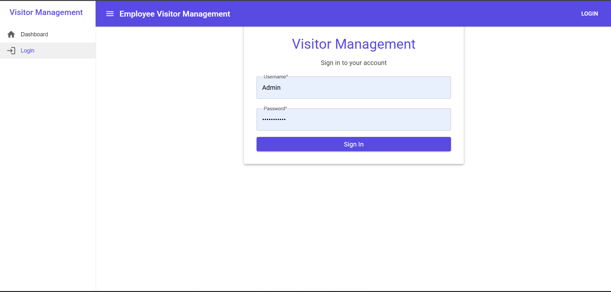

### 2. Dashboard
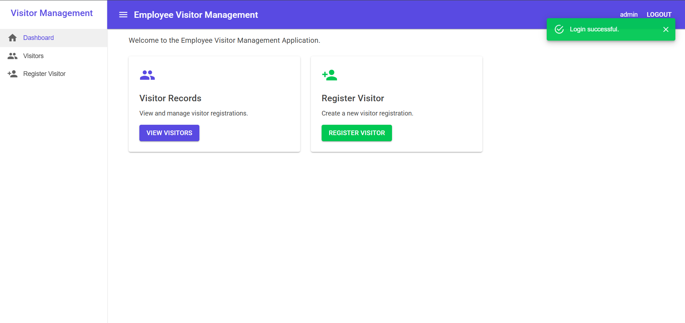

### 3. Visitor List
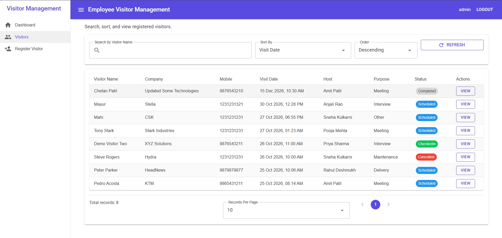

### 4. Visitor Details
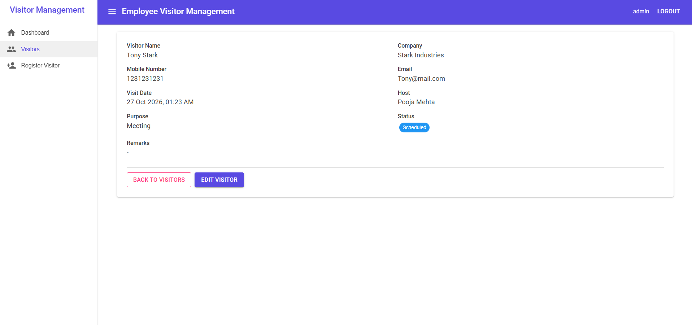

### 5. Edit Visitor
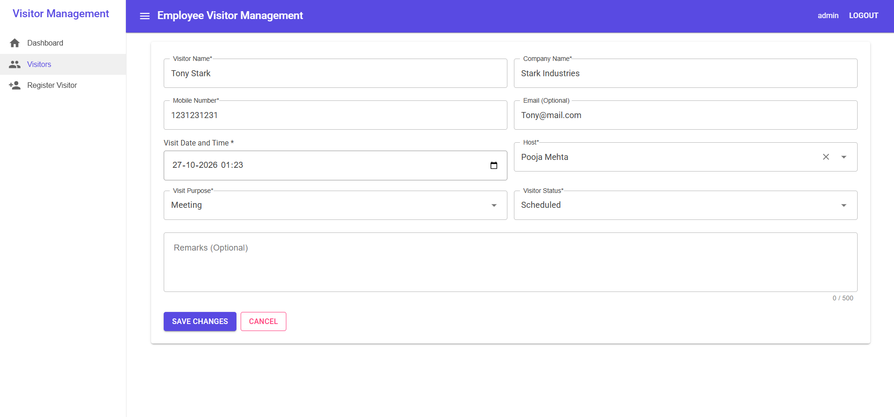

### 6. Register Visitor
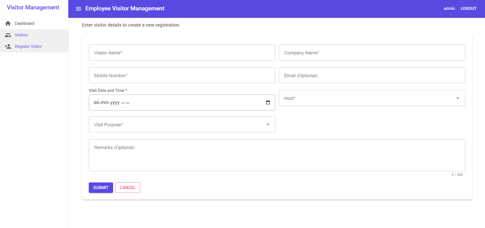

---
# Employee Visitor Management Application

A full-stack employee visitor management system built using **ASP.NET Core 8 Web API, Blazor WebAssembly, MudBlazor, Entity Framework Core, SQL Server, Azure Storage Queues, and Azure Functions**.

The application supports secure authentication, role-based access control, visitor registration, visitor management, audit logging, and asynchronous event processing.

The solution follows a layered architecture with SOLID principles, dependency injection, repository abstractions, and automated testing.

---

## Table of Contents

1. [Project Overview](#1-project-overview)
2. [Features](#2-features)
3. [Technology Stack](#3-technology-stack)
4. [Solution Architecture](#4-solution-architecture)
5. [Project Structure](#5-project-structure)
6. [System Requirements](#6-system-requirements)
7. [Install Required Software](#7-install-required-software)
8. [Clone and Build the Repository](#8-clone-and-build-the-repository)
9. [Configure SQL Server](#9-configure-sql-server)
10. [Configure JWT and Demo Users](#10-configure-jwt-and-demo-users)
11. [Database Migrations and Seeding](#11-database-migrations-and-seeding)
12. [Configure and Run the API](#12-configure-and-run-the-api)
13. [Configure and Run Blazor WebAssembly](#13-configure-and-run-blazor-webassembly)
14. [Install and Configure Azurite](#14-install-and-configure-azurite)
15. [Configure and Run Azure Functions](#15-configure-and-run-azure-functions)
16. [Complete Application Startup Guide](#16-complete-application-startup-guide)
17. [Authentication and Authorization](#17-authentication-and-authorization)
18. [API Endpoints](#18-api-endpoints)
19. [Database Design](#19-database-design)
20. [Visitor Creation and Queue Processing](#20-visitor-creation-and-queue-processing)
21. [Design Principles and Patterns](#21-design-principles-and-patterns)
22. [Testing](#22-testing)
23. [Logging and Error Handling](#23-logging-and-error-handling)
24. [Security Considerations](#24-security-considerations)
25. [Troubleshooting](#25-troubleshooting)
26. [AI Usage Note](#26-ai-usage-note)
27. [Known Limitations and Improvements](#27-known-limitations-and-improvements)
28. [Final Verification Checklist](#28-final-verification-checklist)

---

# 1. Project Overview

The Employee Visitor Management Application is designed to manage visitors entering an organization.

It provides a centralized platform for:

* Registering visitors.
* Assigning visitors to employees or hosts.
* Recording the purpose and scheduled date of visits.
* Searching and managing visitor records.
* Restricting operations according to user roles.
* Tracking changes through audit logs.
* Processing visitor-created events asynchronously.

The application consists of three main runtime components:

1. **ASP.NET Core Web API** — authentication, authorization, business operations, and database access.
2. **Blazor WebAssembly frontend** — interactive browser-based user interface.
3. **Azure Functions worker** — asynchronous processing of visitor-created events.

SQL Server stores application data, while Azure Storage Queues provide messaging between the API and background worker.

For local development, **Azurite** replaces the need for an Azure Storage account.

---

# 2. Features

## Authentication

* JWT-based authentication.
* Username and password login.
* Password hashing using ASP.NET Core Identity password hashing.
* Role-based access control.
* Protected API endpoints.

## Visitor Management

* Register new visitors.
* View visitor details.
* Search visitor records.
* Sort visitor records.
* Paginate visitor lists.
* Update existing visitors.
* Assign hosts and visit purposes.
* Track visitor status.

## Validation

Validation is implemented using FluentValidation.

The application validates:

* Required visitor name.
* Visitor name maximum length of 100 characters.
* Required company name.
* Company name maximum length of 150 characters.
* Mobile numbers containing 10–15 digits, optionally prefixed with `+`.
* Optional email address format.
* Visit dates that are not in the past.
* Valid host selection.
* Valid visit purpose selection.
* Remarks maximum length of 500 characters.

## Audit and Monitoring

* Database audit records.
* Correlation IDs.
* Structured logging using Serilog.
* Centralized exception handling.
* HTTP request logging.

## Asynchronous Processing

* Azure Storage Queue integration.
* Azure Functions queue trigger.
* Idempotent message processing.
* Retry handling.
* Poison queue support.
* Background audit logging.
* Simulated visitor notification processing.

---

# 3. Technology Stack

## Backend

| Technology                | Version | Purpose               |
| ------------------------- | ------- | --------------------- |
| .NET                      | 8       | Application framework |
| ASP.NET Core Web API      | 8       | REST API              |
| Entity Framework Core     | 8.0.11  | ORM                   |
| EF Core SQL Server        | 8.0.11  | Database provider     |
| JWT Bearer Authentication | 8.0.11  | Authentication        |
| FluentValidation          | 11.11.0 | Request validation    |
| Serilog.AspNetCore        | 8.0.3   | Structured logging    |
| Serilog.Sinks.File        | 6.0.0   | File logging          |
| Swashbuckle.AspNetCore    | 6.6.2   | Swagger documentation |

## Frontend

| Technology                 | Version | Purpose                   |
| -------------------------- | ------- | ------------------------- |
| Blazor WebAssembly         | 8.0.14  | Frontend framework        |
| MudBlazor                  | 8.15.0  | UI components             |
| Blazored.LocalStorage      | 4.5.0   | Browser storage           |
| ASP.NET Core Authorization | 8.0.10  | Authorization integration |

## Background Processing

| Technology                       | Version |
| -------------------------------- | ------- |
| Azure Functions Runtime          | v4      |
| .NET Isolated Worker             | 8       |
| Microsoft.Azure.Functions.Worker | 1.19.0  |
| Azure Storage Queues Extension   | 5.5.2   |
| Azure.Storage.Queues             | 12.22.0 |

## Testing

| Technology                       | Version |
| -------------------------------- | ------- |
| xUnit                            | 2.5.3   |
| Moq                              | 4.20.72 |
| Microsoft.AspNetCore.Mvc.Testing | 8.0.10  |
| Microsoft.NET.Test.Sdk           | 17.8.0  |
| coverlet.collector               | 6.0.0   |

All application projects target `net8.0`.

The original development environment also had .NET SDK `10.0.102` installed. A new developer can use a supported .NET 8 SDK without installing SDK 10 specifically.

---

# 4. Solution Architecture

## 4.1 High-Level Architecture

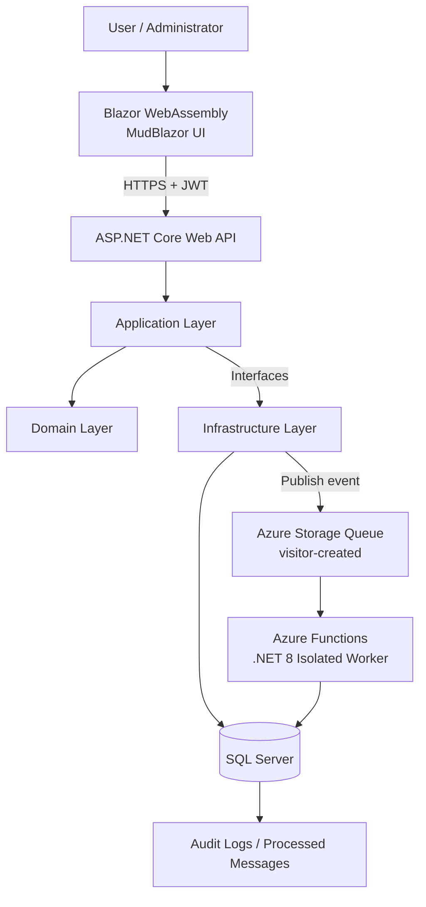

## 4.2 Application Layer Dependencies

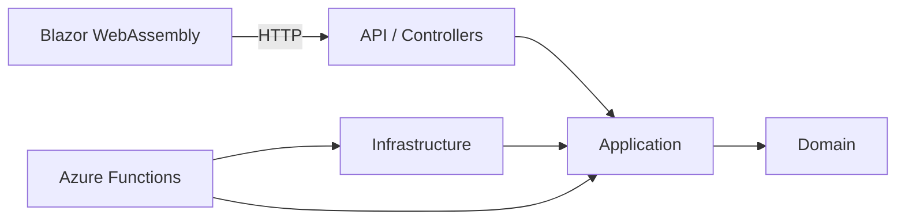

The Application layer defines business operations and interfaces.

Infrastructure provides implementations for database access, authentication, and messaging.

The Domain layer contains core entities and business-related types.

---

# 5. Project Structure

```text
VisitorManagement/
│
├── VisitorManagement.sln
├── README.md
├── .gitignore
│
├── src/
│   │
│   ├── VisitorManagement.Api/
│   │   ├── Controllers/
│   │   ├── Correlation/
│   │   ├── Middleware/
│   │   ├── Models/
│   │   ├── Properties/
│   │   ├── Program.cs
│   │   ├── appsettings.json
│   │   └── VisitorManagement.Api.csproj
│   │
│   ├── VisitorManagement.Application/
│   │   ├── DTOs/
│   │   ├── Events/
│   │   ├── Exceptions/
│   │   ├── Interfaces/
│   │   ├── Services/
│   │   ├── Validators/
│   │   └── VisitorManagement.Application.csproj
│   │
│   ├── VisitorManagement.Domain/
│   │   ├── Entities/
│   │   ├── Enums/
│   │   └── VisitorManagement.Domain.csproj
│   │
│   ├── VisitorManagement.Infrastructure/
│   │   ├── Authentication/
│   │   ├── Messaging/
│   │   ├── Persistence/
│   │   ├── Repositories/
│   │   ├── DependencyInjection.cs
│   │   └── VisitorManagement.Infrastructure.csproj
│   │
│   └── VisitorManagement.Web/
│       ├── Pages/
│       ├── Components/
│       ├── Services/
│       ├── wwwroot/
│       └── VisitorManagement.Web.csproj
│
├── VisitorManagement.Functions/
│   ├── Program.cs
│   ├── VisitorCreatedQueueFunction.cs
│   ├── host.json
│   └── VisitorManagement.Functions.csproj
│
├── tests/
│   ├── VisitorManagement.UnitTests/
│   └── VisitorManagement.IntegrationTests/
│
└── tools/
    └── QueueInspector/
```

**Important:** `VisitorManagement.Functions` is located at the solution root, not inside the `src` directory.

---

# 6. System Requirements

The following setup is intended primarily for Windows developers.

## Required

* Windows 10 or Windows 11.
* Git.
* .NET 8 SDK.
* SQL Server Express, Developer Edition, or another compatible SQL Server instance.
* Visual Studio 2022 with ASP.NET and web development workload, or a suitable .NET IDE.
* Node.js and npm for installing Azurite.
* Azure Functions Core Tools v4.
* A modern browser.

## Recommended

* SQL Server Management Studio (SSMS).
* Visual Studio 2022.
* PowerShell.
* Azure Storage Explorer for inspecting queue messages.

An Azure subscription is **not required** for local development.

---

# 7. Install Required Software

The following commands use Windows PowerShell.

Run installation commands in a terminal with the permissions required by the installer.

## 7.1 Install Git

```powershell
winget install --id Git.Git -e
```

Verify:

```powershell
git --version
```

## 7.2 Install .NET 8 SDK

```powershell
winget install --id Microsoft.DotNet.SDK.8 -e
```

Verify:

```powershell
dotnet --list-sdks
```

Confirm that an `8.0.x` SDK is installed.

Also check the runtime:

```powershell
dotnet --list-runtimes
```

The installed runtime list should include the ASP.NET Core 8 runtime.

## 7.3 Install Visual Studio 2022

Install Visual Studio 2022 using the official Visual Studio installer.

Select the workload:

**ASP.NET and web development**

Recommended additional components:

* .NET SDK.
* SQL Server Data Tools, if needed.
* Git tooling.

Visual Studio is optional if the developer prefers command-line development.

## 7.4 Install SQL Server Express

A developer can install SQL Server Express through the official SQL Server installer.

Alternatively, try the Windows Package Manager:

```powershell
winget search "SQL Server Express"
```

Choose an available Microsoft SQL Server Express package compatible with the development machine.

During installation:

1. Select a suitable SQL Server instance.
2. Enable Windows Authentication.
3. Record the instance name.
4. Ensure the SQL Server service is running.

Example instance:

```text
.\SQLEXPRESS
```

The instance name may differ between computers.

The original development environment used a named SQL Server instance. New developers must use their own instance name.

## 7.5 Install SQL Server Management Studio

SSMS is recommended for viewing tables, users, and audit records.

```powershell
winget search "SQL Server Management Studio"
```

Install the available Microsoft SSMS package or use the official Microsoft installer.

## 7.6 Install Node.js LTS

```powershell
winget install --id OpenJS.NodeJS.LTS -e
```

Close and reopen PowerShell after installation.

Verify:

```powershell
node --version
npm --version
```

Node.js is used for Azurite installation. It is not required to build the Blazor WebAssembly application itself.

## 7.7 Install Azurite

```powershell
npm install -g azurite
```

Verify:

```powershell
azurite --version
```

## 7.8 Install Azure Functions Core Tools v4

```powershell
npm install -g azure-functions-core-tools@4 --unsafe-perm true
```

Verify:

```powershell
func --version
```

The major version should be `4`.

## 7.9 Install Entity Framework CLI

Use EF Core tooling compatible with the application's EF Core 8 packages:

```powershell
dotnet tool install --global dotnet-ef --version 8.0.11
```

If `dotnet-ef` is already installed, check its version:

```powershell
dotnet ef --version
```

To update an existing global installation:

```powershell
dotnet tool update --global dotnet-ef --version 8.0.11
```

---

# 8. Clone and Build the Repository

## 8.1 Clone

```powershell
git clone <REPOSITORY-CLONE-URL>
```

The repository is private, so GitHub authentication and repository access are required.

Navigate into the repository:

```powershell
cd VisitorManagement
```

## 8.2 Verify Solution

```powershell
Get-ChildItem *.sln
```

Expected:

```text
VisitorManagement.sln
```

## 8.3 Restore NuGet Packages

```powershell
dotnet restore VisitorManagement.sln
```

NuGet downloads the package versions specified in the project files.

There is no need to manually reinstall each NuGet package.

## 8.4 Build

```powershell
dotnet build VisitorManagement.sln
```

Expected:

```text
Build succeeded.
```

If the solution builds successfully, proceed with application configuration.

---

# 9. Configure SQL Server

The API and Azure Functions worker both use SQL Server.

## 9.1 Identify the SQL Server Instance

Open SSMS and connect using Windows Authentication.

Common server names include:

```text
.\SQLEXPRESS
```

```text
localhost\SQLEXPRESS
```

```text
(localdb)\MSSQLLocalDB
```

Use the instance that actually exists on the computer.

## 9.2 Example Connection String

For a local SQL Server Express instance:

```text
Server=.\SQLEXPRESS;Database=VisitorManagementDb;Trusted_Connection=True;TrustServerCertificate=True;
```

For SQL Server LocalDB:

```text
Server=(localdb)\MSSQLLocalDB;Database=VisitorManagementDb;Trusted_Connection=True;TrustServerCertificate=True;
```

The database name is configurable.

For consistency, this guide uses:

```text
VisitorManagementDb
```

## 9.3 Database Configuration Key

The application expects:

```text
ConnectionStrings:DefaultConnection
```

This key is required by:

```text
VisitorManagement.Infrastructure/DependencyInjection.cs
```

If it is missing, the application throws:

```text
Database connection string is not configured.
```

The next section configures the connection string securely using .NET User Secrets.

---

# 10. Configure JWT and Demo Users

The API requires the following configuration:

```text
ConnectionStrings:DefaultConnection
Jwt:Key
Jwt:Issuer
Jwt:Audience
Jwt:ExpirationMinutes
SeedUsers:AdminPassword
SeedUsers:UserPassword
```

## 10.1 Why User Secrets?

Do not commit real JWT signing keys or passwords to Git.

For local development, use the .NET User Secrets configuration provider.

The API project already has a `UserSecretsId`.

## 10.2 Configure the API

Run these commands from the solution root.

Set the database connection string:

```powershell
dotnet user-secrets set "ConnectionStrings:DefaultConnection" "Server=.\SQLEXPRESS;Database=VisitorManagementDb;Trusted_Connection=True;TrustServerCertificate=True;" --project "src/VisitorManagement.Api/VisitorManagement.Api.csproj"
```

Change `.\SQLEXPRESS` if your SQL Server instance has another name.

## 10.3 Generate a JWT Signing Key

Generate a random signing key:

```powershell
$jwtKey = [Convert]::ToBase64String(
    [System.Security.Cryptography.RandomNumberGenerator]::GetBytes(48)
)
```

Save it to API User Secrets:

```powershell
dotnet user-secrets set "Jwt:Key" "$jwtKey" --project "src/VisitorManagement.Api/VisitorManagement.Api.csproj"
```

The signing key must contain at least 32 UTF-8 bytes.

Use a unique random key for each environment.

## 10.4 Configure JWT Issuer

```powershell
dotnet user-secrets set "Jwt:Issuer" "VisitorManagement.Api" --project "src/VisitorManagement.Api/VisitorManagement.Api.csproj"
```

## 10.5 Configure JWT Audience

```powershell
dotnet user-secrets set "Jwt:Audience" "VisitorManagement.Web" --project "src/VisitorManagement.Api/VisitorManagement.Api.csproj"
```

## 10.6 Configure Token Expiration

```powershell
dotnet user-secrets set "Jwt:ExpirationMinutes" "60" --project "src/VisitorManagement.Api/VisitorManagement.Api.csproj"
```

Tokens will expire after 60 minutes.

## 10.7 Configure Initial Admin Password

```powershell
dotnet user-secrets set "SeedUsers:AdminPassword" "Admin@12345" --project "src/VisitorManagement.Api/VisitorManagement.Api.csproj"
```

## 10.8 Configure Initial User Password

```powershell
dotnet user-secrets set "SeedUsers:UserPassword" "User@12345" --project "src/VisitorManagement.Api/VisitorManagement.Api.csproj"
```

These are **local demonstration credentials only**.

Do not use them in production.

## 10.9 Verify Configuration

```powershell
dotnet user-secrets list --project "src/VisitorManagement.Api/VisitorManagement.Api.csproj"
```

This displays stored values, including secrets. Run it only in a private terminal and do not share its output publicly.

## 10.10 Configure CORS

The Blazor application runs on a different local origin from the API.

Configure the allowed frontend origins:

```powershell
dotnet user-secrets set "Cors:AllowedOrigins:0" "https://localhost:7087" --project "src/VisitorManagement.Api/VisitorManagement.Api.csproj"
```

```powershell
dotnet user-secrets set "Cors:AllowedOrigins:1" "http://localhost:5069" --project "src/VisitorManagement.Api/VisitorManagement.Api.csproj"
```

The API's CORS policy reads:

```text
Cors:AllowedOrigins
```

The HTTPS frontend origin is recommended.

If the frontend runs on another port, update the allowed origins accordingly.

---

# 11. Database Migrations and Seeding

## 11.1 Existing Migrations

The repository contains EF Core database migrations in the Infrastructure project.

A new developer should normally **apply existing migrations**, not generate a new initial migration.

## 11.2 Automatic Migration and Seeding

When the API runs in the `Development` environment, `Program.cs` executes:

```csharp
await context.Database.MigrateAsync();
await seeder.SeedAsync();
```

This means the API automatically:

1. Connects to SQL Server.
2. Creates or updates the database using existing migrations.
3. Creates application roles.
4. Creates demo users.
5. Creates sample hosts.
6. Creates visit purposes.
7. Creates sample visitors.

The SQL Server login must have sufficient permissions to create and update the development database.

## 11.3 Manual Migration Command

To apply migrations manually:

```powershell
dotnet ef database update --project "src/VisitorManagement.Infrastructure/VisitorManagement.Infrastructure.csproj" --startup-project "src/VisitorManagement.Api/VisitorManagement.Api.csproj" --context ApplicationDbContext
```

Ensure the API configuration is available and SQL Server is running.

## 11.4 Verify Database Tables

After starting the API, open SSMS and inspect:

```text
VisitorManagementDb
```

Expected application tables include:

```text
Roles
Users
Hosts
VisitPurposes
Visitors
AuditLogs
ProcessedMessages
```

EF Core also maintains migration history.

## 11.5 Seeded Roles

```text
Admin
User
```

## 11.6 Seeded Accounts

| Username | Initial local password | Role  |
| -------- | ---------------------- | ----- |
| admin    | Admin@12345            | Admin |
| user     | User@12345             | User  |

Passwords are stored as hashes, not plaintext.

The seeder reads passwords from:

```text
SeedUsers:AdminPassword
SeedUsers:UserPassword
```

**Important:** The seeder creates missing users. It does not reset passwords for users that already exist.

Changing the User Secrets password after the account has been created will not automatically change that account's stored password.

## 11.7 Seeded Hosts

The application creates ten sample hosts across departments such as:

* IT
* HR
* Finance
* Administration
* Operations
* Security
* Management

## 11.8 Seeded Visit Purposes

```text
Meeting
Interview
Delivery
Maintenance
Other
```

## 11.9 Seeded Visitors

The database seeder creates three demonstration visitor records when the Visitors table is empty.

This provides initial data for testing the visitor list and details screens.

---

# 12. Configure and Run the API

## 12.1 Start SQL Server

Ensure the configured SQL Server instance is running.

## 12.2 Start Azurite

The API registers Azure Storage Queue messaging, so start Azurite before testing visitor creation.

See Section 14 for installation and startup details.

## 12.3 Trust the Local HTTPS Certificate

Run once:

```powershell
dotnet dev-certs https --trust
```

Approve the certificate prompt.

## 12.4 Run the API

From the solution root:

```powershell
dotnet run --project "src/VisitorManagement.Api/VisitorManagement.Api.csproj" --launch-profile https
```

Expected API addresses:

```text
https://localhost:7219
http://localhost:5084
```

## 12.5 Open Swagger

Open the Swagger UI at:

```text
https://localhost:7219/swagger
```

Swagger is enabled in the Development environment.

## 12.6 Login Through Swagger

Find:

```text
POST /api/auth/login
```

Example request:

```json
{
  "username": "admin",
  "password": "Admin@12345"
}
```

A successful response contains a JWT access token and user information.

Use Swagger's **Authorize** button to supply the token.

The authorization scheme is Bearer JWT.

## 12.7 API Environment

The API's launch profile sets:

```text
ASPNETCORE_ENVIRONMENT=Development
```

Development mode enables:

* Swagger.
* Automatic migrations.
* Database seeding.

Do not enable these development-only behaviors in production without reviewing the security implications.

---

# 13. Configure and Run Blazor WebAssembly

The frontend project is:

```text
src/VisitorManagement.Web
```

It uses Blazor WebAssembly and MudBlazor.

## 13.1 API Base URL

The frontend reads:

```text
src/VisitorManagement.Web/wwwroot/appsettings.json
```

Expected configuration:

```json
{
  "Api": {
    "BaseUrl": "https://localhost:7219/"
  }
}
```

If the API uses another address, update this value.

The URL must end with `/`.

## 13.2 Start the API First

The frontend requires the API for login and visitor operations.

Confirm the API is running before launching the frontend.

## 13.3 Run Blazor

Open another PowerShell terminal.

From the solution root:

```powershell
dotnet run --project "src/VisitorManagement.Web/VisitorManagement.Web.csproj" --launch-profile https
```

Expected frontend addresses:

```text
https://localhost:7087
http://localhost:5069
```

Open:

```text
https://localhost:7087
```

## 13.4 Login

Use the local demo accounts:

**Administrator**

```text
Username: admin
Password: Admin@12345
```

**Standard User**

```text
Username: user
Password: User@12345
```

## 13.5 Role-Based UI

The frontend provides role-aware access to visitor management functionality.

Administrative operations are restricted to Admin users.

Authorization is also enforced by the API, so frontend restrictions are not the only security boundary.

## 13.6 Browser Storage

The frontend uses Blazored.LocalStorage for client-side token storage.

This simplifies local development, but browser-accessible token storage requires careful XSS protection in production.

---

# 14. Install and Configure Azurite

Azurite is a local Azure Storage emulator.

It allows developers to test Azure Storage Queues without an Azure subscription.

## 14.1 Install

```powershell
npm install -g azurite
```

## 14.2 Verify

```powershell
azurite --version
```

## 14.3 Create a Storage Directory

From the solution root:

```powershell
New-Item -ItemType Directory -Force ".azurite" | Out-Null
```

The `.azurite` directory is excluded from Git.

## 14.4 Start Azurite

Open a dedicated PowerShell terminal:

```powershell
azurite --location ".azurite" --debug ".azurite/debug.log"
```

Leave this terminal running.

Default emulator endpoints include:

| Service | Port  |
| ------- | ----- |
| Blob    | 10000 |
| Queue   | 10001 |
| Table   | 10002 |

The application primarily uses the Queue service.

## 14.5 API Storage Configuration

The API's Development configuration uses:

```json
{
  "AzureStorage": {
    "ConnectionString": "UseDevelopmentStorage=true"
  }
}
```

The configuration key is:

```text
AzureStorage:ConnectionString
```

The API reads this key when registering queue messaging.

If `appsettings.Development.json` is absent from a fresh clone, configure the value using API User Secrets:

```powershell
dotnet user-secrets set "AzureStorage:ConnectionString" "UseDevelopmentStorage=true" --project "src/VisitorManagement.Api/VisitorManagement.Api.csproj"
```

This is recommended because the repository's `.gitignore` excludes `appsettings.Development.json`.

## 14.6 Queue Name

The API publishes messages to:

```text
visitor-created
```

The queue publisher uses the Azure Storage Queues SDK.

The Azure Functions worker listens to the same queue.

## 14.7 Create the Queue

The queue publisher is designed to create the queue if it does not already exist.

For manual queue inspection or creation, developers can also use Azure Storage Explorer or the repository's QueueInspector utility.

---

# 15. Configure and Run Azure Functions

The Azure Functions project is:

```text
VisitorManagement.Functions
```

It uses:

```text
Azure Functions Runtime v4
.NET 8 Isolated Worker
```

## 15.1 Local Configuration

Create:

```text
VisitorManagement.Functions/local.settings.json
```

This file is excluded from Git and must be created on every new development machine.

Use the following template:

```json
{
  "IsEncrypted": false,
  "Values": {
    "AzureWebJobsStorage": "UseDevelopmentStorage=true",
    "FUNCTIONS_WORKER_RUNTIME": "dotnet-isolated",
    "ConnectionStrings__DefaultConnection": "Server=.\\SQLEXPRESS;Database=VisitorManagementDb;Trusted_Connection=True;TrustServerCertificate=True;"
  }
}
```

Replace `.\SQLEXPRESS` with the actual SQL Server instance.

The Functions SQL Server connection string must point to the **same database used by the API**.

## 15.2 Configuration Keys

| Key                                  | Purpose                                      |
| ------------------------------------ | -------------------------------------------- |
| AzureWebJobsStorage                  | Storage connection used by the queue trigger |
| FUNCTIONS_WORKER_RUNTIME             | Selects the .NET isolated worker             |
| ConnectionStrings__DefaultConnection | SQL Server connection string                 |

The double underscore in:

```text
ConnectionStrings__DefaultConnection
```

is intentional.

The Functions startup code supports this configuration format.

## 15.3 Restore and Build

From the solution root:

```powershell
dotnet restore "VisitorManagement.Functions/VisitorManagement.Functions.csproj"
```

Build:

```powershell
dotnet build "VisitorManagement.Functions/VisitorManagement.Functions.csproj" --disable-build-servers
```

## 15.4 Troubleshooting Worker Build Errors

Some Windows development environments may encounter an Azure Functions WorkerExtensions build error related to:

```text
DOTNET_STARTUP_HOOKS
```

If this happens, open a new PowerShell terminal and run:

```powershell
Remove-Item Env:DOTNET_STARTUP_HOOKS -ErrorAction SilentlyContinue
```

Then rebuild:

```powershell
dotnet build "VisitorManagement.Functions/VisitorManagement.Functions.csproj" --disable-build-servers
```

This workaround was required in the original development environment.

## 15.5 Start the Function Host

Ensure:

1. SQL Server is running.
2. Azurite is running.
3. `local.settings.json` exists.
4. The Functions project has been built.

From the solution root:

```powershell
Set-Location "VisitorManagement.Functions"
```

For a normal Functions Core Tools setup, run:

```powershell
func start
```

If the local WorkerExtensions build issue occurs, use the previously verified output-directory approach:

```powershell
Set-Location "bin/Debug/net8.0"
```

```powershell
func start --no-build
```

Keep the Functions terminal open.

## 15.6 Function Trigger

The worker listens to:

```text
visitor-created
```

The trigger uses:

```text
AzureWebJobsStorage
```

## 15.7 Retry Configuration

The project's `host.json` contains:

```json
{
  "version": "2.0",
  "logging": {
    "applicationInsights": {
      "samplingSettings": {
        "isEnabled": true,
        "excludedTypes": "Request"
      }
    }
  },
  "extensions": {
    "queues": {
      "maxDequeueCount": 5,
      "visibilityTimeout": "00:00:10",
      "batchSize": 1,
      "newBatchThreshold": 0
    }
  }
}
```

The queue processor retries failed messages according to these settings.

After repeated failures, messages can be moved to the poison queue:

```text
visitor-created-poison
```

## 15.8 Idempotency

The worker uses the `ProcessedMessages` table to prevent duplicate processing of the same message.

A repeated event with an already-processed MessageId should not create duplicate processing records.

---

# 16. Complete Application Startup Guide

This section describes the recommended startup order for a developer who has already completed the one-time installation and configuration.

## First-Time Setup

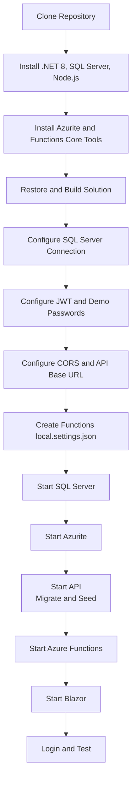

## Daily Startup

Use separate terminals.

### Terminal 1 — Azurite

```powershell
cd "C:\Path\To\VisitorManagement"
```

```powershell
azurite --location ".azurite" --debug ".azurite/debug.log"
```

### Terminal 2 — API

```powershell
cd "C:\Path\To\VisitorManagement"
```

```powershell
dotnet run --project "src/VisitorManagement.Api/VisitorManagement.Api.csproj" --launch-profile https
```

### Terminal 3 — Azure Functions

```powershell
cd "C:\Path\To\VisitorManagement\VisitorManagement.Functions"
```

```powershell
func start
```

If the WorkerExtensions issue occurs, use the documented `--no-build` workaround.

### Terminal 4 — Blazor

```powershell
cd "C:\Path\To\VisitorManagement"
```

```powershell
dotnet run --project "src/VisitorManagement.Web/VisitorManagement.Web.csproj" --launch-profile https
```

## Application Addresses

| Component             | Address                           |
| --------------------- | --------------------------------- |
| API                   | `https://localhost:7219`          |
| Swagger               | `https://localhost:7219/swagger`  |
| Blazor                | `https://localhost:7087`          |
| Azure Functions host  | Typically `http://localhost:7071` |
| Azurite Queue service | `http://127.0.0.1:10001`          |

These are local development defaults. Actual addresses may differ if ports are changed.

---

# 17. Authentication and Authorization

## 17.1 Authentication Flow

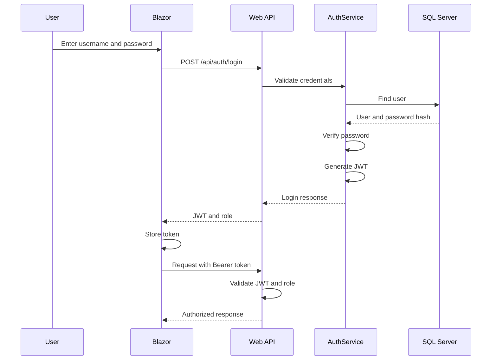

## 17.2 Roles

### Admin

Can:

* Log in.
* View visitor records.
* Search visitors.
* View visitor details.
* Create visitors.
* Update visitors.

### User

Can:

* Log in.
* View visitor records.
* Search visitors.
* View visitor details.

User accounts cannot perform Admin-only visitor creation or update operations.

## 17.3 Authorization Matrix

| Operation                 | Admin | User | Anonymous |
| ------------------------- | ----- | ---- | --------- |
| Login                     | Yes   | Yes  | Yes       |
| View profile              | Yes   | Yes  | No        |
| List visitors             | Yes   | Yes  | No        |
| View visitor details      | Yes   | Yes  | No        |
| Create visitor            | Yes   | No   | No        |
| Update visitor            | Yes   | No   | No        |
| Admin authorization check | Yes   | No   | No        |

## 17.4 JWT Claims

Generated JWTs include:

* User ID.
* Username.
* Role.
* Token identifier.
* Issuer.
* Audience.
* Expiration.

The API validates the token signature, issuer, audience, and expiration.

---

# 18. API Endpoints

## Authentication

| Method | Endpoint                | Access        |
| ------ | ----------------------- | ------------- |
| POST   | `/api/auth/login`       | Anonymous     |
| GET    | `/api/auth/profile`     | Authenticated |
| GET    | `/api/auth/admin-check` | Admin         |

## Visitor Management

| Method | Endpoint             | Access      |
| ------ | -------------------- | ----------- |
| POST   | `/api/visitors`      | Admin       |
| GET    | `/api/visitors`      | Admin, User |
| GET    | `/api/visitors/{id}` | Admin, User |
| PUT    | `/api/visitors/{id}` | Admin       |

## Lookups

| Method | Endpoint             | Purpose                 |
| ------ | -------------------- | ----------------------- |
| GET    | `/api/hosts?search=` | Search hosts            |
| GET    | `/api/purposes`      | Retrieve visit purposes |

Refer to Swagger for the current endpoint request and response schemas.

## Example Visitor Creation Request

```json
{
  "visitorName": "Rahul Sharma",
  "companyName": "ABC Technologies",
  "mobileNumber": "9876543210",
  "email": "rahul@example.com",
  "visitDate": "2030-01-15T10:30:00",
  "hostId": 1,
  "purposeId": 1,
  "remarks": "Business meeting"
}
```

The visit date must be in the future.

A successful creation returns:

```text
201 Created
```

## Common HTTP Responses

| Code | Meaning                                         |
| ---- | ----------------------------------------------- |
| 200  | Request successful                              |
| 201  | Resource created                                |
| 400  | Invalid request                                 |
| 401  | Authentication required or credentials rejected |
| 403  | Insufficient permissions                        |
| 404  | Resource not found                              |
| 409  | Concurrency conflict                            |
| 500  | Unexpected server error                         |

---

# 19. Database Design

The application uses SQL Server with Entity Framework Core.

## 19.1 Entity Relationship Diagram

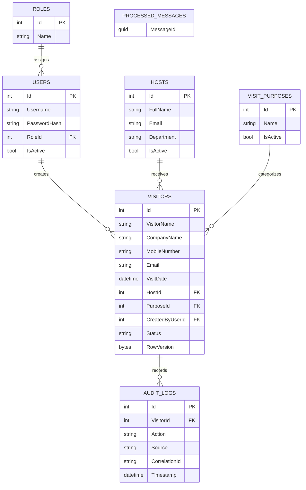

The diagram is a simplified logical view of the main relationships.

For exact column types, constraints, and indexes, refer to the EF Core entities, configurations, and migrations.

## 19.2 Visitor Status

Supported visitor statuses include:

```text
Scheduled
CheckedIn
Completed
Cancelled
```

## 19.3 Optimistic Concurrency

Visitor records use a `RowVersion` concurrency token.

This helps detect conflicting updates.

When an update is attempted using an outdated version, the API can return:

```text
409 Conflict
```

---

# 20. Visitor Creation and Queue Processing

## 20.1 Event Processing Flow

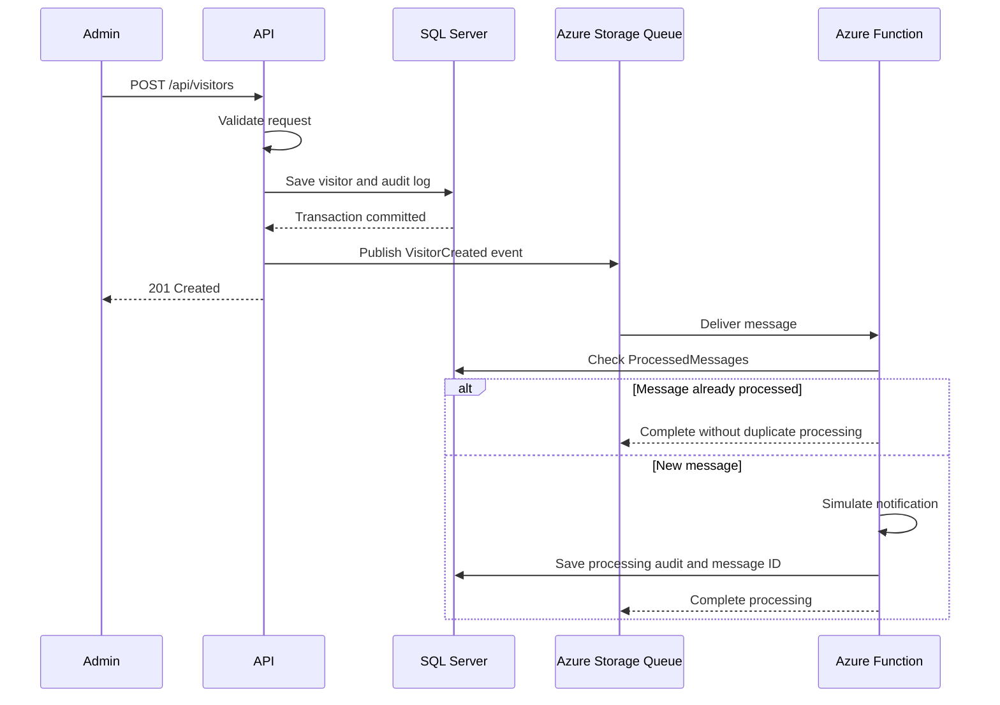

## 20.2 Event Payload

The queue message contains:

```json
{
  "messageId": "11111111-2222-3333-4444-555555555555",
  "correlationId": "example-correlation-id",
  "visitorId": 101,
  "eventType": "VisitorCreated",
  "occurredAt": "2030-01-15T10:30:00Z"
}
```

## 20.3 Database and Queue Behavior

Visitor creation follows this sequence:

1. Validate the request.
2. Validate host and purpose references.
3. Save the visitor.
4. Create the database audit record.
5. Commit the database transaction.
6. Publish the visitor-created event.
7. Return the visitor response.

Queue publication is best-effort.

If the queue is unavailable after the database transaction commits, the API logs a warning and still returns the saved visitor.

This prevents a temporary queue failure from incorrectly reporting that a successfully saved visitor was not created.

## 20.4 Important Reliability Limitation

Database persistence and queue publication are separate operations.

The current implementation does not use a transactional outbox.

Therefore, if queue publication fails, the visitor remains saved, but the event may not be delivered automatically later.

A transactional outbox would improve reliability in a production system.

## 20.5 Retry and Poison Queue

The Functions host retries failed queue processing.

Configured settings:

```text
Maximum dequeue count: 5
Visibility timeout: 10 seconds
```

Messages that repeatedly fail can move to:

```text
visitor-created-poison
```

## 20.6 Idempotency

The `ProcessedMessages` table stores processed message identifiers.

This allows the worker to recognize repeated deliveries and avoid processing the same event multiple times.

## 20.7 QueueInspector

The repository includes:

```text
tools/QueueInspector
```

This utility was created for local queue diagnostics.

Build it using:

```powershell
dotnet build "tools/QueueInspector/QueueInspector.csproj"
```

Run it using:

```powershell
dotnet run --project "tools/QueueInspector/QueueInspector.csproj"
```

The utility supports queue inspection and test-message operations. Refer to its source code for the exact supported command arguments.

---

# 21. Design Principles and Patterns

The application uses SOLID principles and several common enterprise application patterns.

## 21.1 Single Responsibility Principle

Each class has a focused responsibility.

Examples:

* Controllers handle HTTP requests.
* Services coordinate business operations.
* Validators validate input.
* Repositories perform data access.
* Queue publishers send events.
* Azure Functions process background messages.

## 21.2 Open/Closed Principle

The application uses interfaces and dependency injection.

Implementations can be replaced without requiring controllers to depend directly on infrastructure details.

## 21.3 Liskov Substitution Principle

Interface implementations can be substituted with compatible implementations or test doubles.

For example, Moq substitutes repository and authentication service interfaces during automated tests.

## 21.4 Interface Segregation Principle

The application defines focused interfaces, including:

```text
IVisitorRepository
IHostRepository
IPurposeRepository
IUserRepository
IAuditLogRepository
IVisitorService
IAuthService
IVisitorEventPublisher
IUnitOfWork
```

Consumers depend on the operations relevant to their responsibilities.

## 21.5 Dependency Inversion Principle

Application services depend on abstractions rather than concrete SQL Server or Azure Queue implementations.

Infrastructure registers concrete implementations through dependency injection.

## 21.6 Repository Pattern

Repository interfaces isolate application services from EF Core database queries.

## 21.7 Unit of Work

The Unit of Work abstraction coordinates transactional database operations.

Visitor creation saves the visitor and its database audit record within a transaction.

## 21.8 Dependency Injection

ASP.NET Core's built-in dependency injection container manages service lifetimes and dependencies.

## 21.9 DTO Pattern

Data Transfer Objects define API request and response contracts.

They avoid exposing database entities directly through the API.

## 21.10 Asynchronous Messaging

Azure Storage Queues decouple visitor registration from background event processing.

---

# 22. Testing

The solution includes automated unit tests and API integration tests.

## 22.1 Test Projects

```text
tests/VisitorManagement.UnitTests
tests/VisitorManagement.IntegrationTests
```

## 22.2 Run All Tests

From the solution root:

```powershell
dotnet test VisitorManagement.sln
```

## 22.3 Run Unit Tests

```powershell
dotnet test "tests/VisitorManagement.UnitTests/VisitorManagement.UnitTests.csproj"
```

## 22.4 Run Integration Tests

```powershell
dotnet test "tests/VisitorManagement.IntegrationTests/VisitorManagement.IntegrationTests.csproj"
```

## 22.5 Verified Results

At the completion of the assessment testing stage:

| Test category     | Passed | Failed |
| ----------------- | -----: | -----: |
| Unit tests        |     20 |      0 |
| Integration tests |      6 |      0 |
| **Total**         | **26** |  **0** |

## 22.6 Unit Test Coverage

Unit tests cover:

* Visitor creation.
* Visitor persistence interactions.
* Database audit creation.
* Event publication.
* Queue publication failure handling.
* Visitor request validation.
* Required fields.
* Field length restrictions.
* Mobile number validation.
* Email validation.
* Visit date validation.
* Host and purpose validation.

## 22.7 Integration Test Coverage

Integration tests cover:

* Unauthorized visitor endpoint access.
* Invalid login credentials.
* Authenticated profile access.
* User access to Admin-only endpoints.
* Admin access to Admin-only endpoints.
* Anonymous access to Admin-only endpoints.

## 22.8 Integration Test Isolation

The API integration tests use ASP.NET Core `WebApplicationFactory`.

They run the application using the `Testing` environment to avoid Development-only database migration and seeding.

The invalid-login test replaces the authentication service with a mock.

Role authorization tests use test-generated JWTs.

These tests verify HTTP and authorization behavior but are not a replacement for full SQL Server-backed end-to-end testing.

## 22.9 Code Coverage

Generate code coverage results using:

```powershell
dotnet test VisitorManagement.sln --collect:"XPlat Code Coverage"
```

Coverage files are generated under test result directories.

---

# 23. Logging and Error Handling

## 23.1 Serilog

The API uses Serilog for structured logging.

Logs are written to:

* Console.
* Rolling log files.

Development log files use a path similar to:

```text
logs/visitor-management-YYYYMMDD.log
```

The log directory is excluded from Git.

## 23.2 Correlation IDs

Each request receives a correlation ID.

Correlation IDs help connect:

* HTTP requests.
* Application service operations.
* Database audit records.
* Queue events.
* Background processing logs.

## 23.3 Centralized Exception Handling

The API uses centralized middleware for exception handling.

This provides consistent error responses.

## 23.4 Example Error Response

An error response can include:

```json
{
  "status": 400,
  "title": "Validation Failed",
  "message": "Please correct the highlighted fields.",
  "correlationId": "example-correlation-id"
}
```

The exact JSON properties depend on the application's `ApiErrorResponse` model.

## 23.5 Audit Sources

Audit records distinguish between operations originating from:

```text
DB
FUNCTION
```

This helps identify whether an operation was recorded during API persistence or background processing.

---

# 24. Security Considerations

## 24.1 Password Storage

Passwords are hashed using ASP.NET Core Identity password hashing.

Plaintext passwords are not stored in the Users table.

## 24.2 JWT Security

JWTs are signed using a configured secret key.

The API validates:

* Signing key.
* Issuer.
* Audience.
* Token lifetime.

## 24.3 Secrets Management

Do not commit:

```text
local.settings.json
appsettings.Development.json containing secrets
.env
Database passwords
Production JWT keys
```

Use .NET User Secrets for local API configuration.

Use a secure secret-management solution for production.

## 24.4 Role-Based Authorization

Authorization is enforced at the API endpoint level.

Do not rely only on frontend role visibility.

## 24.5 HTTPS

Use HTTPS for API and frontend communication.

Production deployments should enforce HTTPS and use trusted certificates.

## 24.6 Browser Token Storage

The current frontend uses browser local storage for JWT persistence.

For a production system, review token-storage risks and consider stronger session-management approaches.

## 24.7 Demo Credentials

The demo accounts are intended for local testing only.

Do not deploy known demonstration passwords to production.

## 24.8 SQL Server

Use least-privilege database accounts in production.

Development database migration permissions should not automatically be granted to production application identities.

## 24.9 Azure Storage

Azurite is intended for local development.

Production environments should use appropriately secured Azure Storage services and managed identities where applicable.

---

# 25. Troubleshooting

## 25.1 Database Connection String Missing

Error:

```text
Database connection string is not configured.
```

Cause:

```text
ConnectionStrings:DefaultConnection
```

is missing.

Fix:

```powershell
dotnet user-secrets set "ConnectionStrings:DefaultConnection" "Server=.\SQLEXPRESS;Database=VisitorManagementDb;Trusted_Connection=True;TrustServerCertificate=True;" --project "src/VisitorManagement.Api/VisitorManagement.Api.csproj"
```

## 25.2 JWT Signing Key Missing

Error:

```text
JWT signing key must contain at least 32 UTF-8 bytes.
```

Generate a new key:

```powershell
$jwtKey = [Convert]::ToBase64String(
    [System.Security.Cryptography.RandomNumberGenerator]::GetBytes(48)
)
```

Configure it:

```powershell
dotnet user-secrets set "Jwt:Key" "$jwtKey" --project "src/VisitorManagement.Api/VisitorManagement.Api.csproj"
```

## 25.3 Demo Password Configuration Missing

Error:

```text
Required demo password configuration is missing.
```

Configure both passwords:

```powershell
dotnet user-secrets set "SeedUsers:AdminPassword" "Admin@12345" --project "src/VisitorManagement.Api/VisitorManagement.Api.csproj"
```

```powershell
dotnet user-secrets set "SeedUsers:UserPassword" "User@12345" --project "src/VisitorManagement.Api/VisitorManagement.Api.csproj"
```

Restart the API.

## 25.4 SQL Server Connection Failure

Check:

1. SQL Server is installed.
2. The SQL Server service is running.
3. The instance name is correct.
4. Windows Authentication is available.
5. The configured account has database permissions.

Use SSMS to verify connectivity.

## 25.5 CORS Error

Symptoms:

```text
Access to fetch has been blocked by CORS policy.
```

Verify:

* API is running.
* Frontend API BaseUrl is correct.
* Frontend origin is included in `Cors:AllowedOrigins`.
* HTTPS and HTTP origins are not accidentally mixed.

## 25.6 Azurite Connection Refused

Symptoms may include:

```text
Connection refused
127.0.0.1:10001
```

Start Azurite:

```powershell
azurite --location ".azurite" --debug ".azurite/debug.log"
```

Confirm that the Queue service is listening on port `10001`.

## 25.7 Azure Functions Cannot Connect to SQL Server

Check:

```text
VisitorManagement.Functions/local.settings.json
```

Verify:

```text
ConnectionStrings__DefaultConnection
```

Ensure the connection string points to the same SQL Server database as the API.

## 25.8 Azure Functions WorkerExtensions Error

Clear the startup hooks environment variable:

```powershell
Remove-Item Env:DOTNET_STARTUP_HOOKS -ErrorAction SilentlyContinue
```

Rebuild:

```powershell
dotnet build "VisitorManagement.Functions/VisitorManagement.Functions.csproj" --disable-build-servers
```

If needed, run the host from the build output directory with `--no-build`.

## 25.9 HTTPS Certificate Error

Run:

```powershell
dotnet dev-certs https --trust
```

Restart the browser and development servers.

## 25.10 Port Already in Use

Find the process using a port:

```powershell
netstat -ano | findstr :7219
```

Replace `7219` with the required port.

Identify the process:

```powershell
Get-Process -Id <PROCESS_ID>
```

Stop the conflicting process if appropriate, or change the application's port configuration.

## 25.11 Tests Fail Because Configuration Is Missing

The integration tests configure their own test environment.

Do not assume the integration test configuration is suitable for running the development API.

For normal development, configure the API using the steps in Section 10.

## 25.12 Visitor Saved but Queue Event Not Processed

Check:

1. Azurite is running.
2. The API can reach Azurite.
3. The `visitor-created` queue exists.
4. Azure Functions is running.
5. The Functions SQL Server connection is correct.
6. The message has not moved to the poison queue.

The current implementation intentionally allows the visitor record to remain saved if queue publication fails.

---

# 26. AI Usage Note

AI assistance was used during the development of this assessment project.

AI-assisted activities included:

* Planning the solution architecture.
* Explaining .NET and Azure development concepts.
* Suggesting implementation approaches.
* Drafting and reviewing code.
* Troubleshooting build and runtime errors.
* Developing automated tests.
* Preparing technical documentation.

Implementation steps were carried out in the local development environment, and functionality was checked through builds, manual verification, and automated tests.

The final repository contains the application's source code and configuration structure.

AI-generated suggestions should be reviewed and validated before production use.

---

# 27. Known Limitations and Improvements

The application is designed as a functional assessment project rather than a production-ready enterprise deployment.

Potential future improvements include:

### Transactional Outbox

Use a transactional outbox to ensure visitor-created events are eventually published even when Azure Storage is temporarily unavailable.

### Real Notification Integration

Replace simulated notifications with an email, SMS, or another notification provider.

### Production Secret Management

Use a managed secret store instead of development configuration mechanisms.

### Improved Token Management

Consider refresh tokens, token revocation, and stronger browser session security.

### Expanded Integration Testing

Add database-backed integration tests covering:

* Visitor creation.
* Visitor updates.
* Optimistic concurrency conflicts.
* Database audit persistence.
* End-to-end queue processing.

### Deployment Automation

Add CI/CD pipelines for:

* Build.
* Test.
* Static analysis.
* Deployment.

### Monitoring

Introduce centralized monitoring and distributed tracing for API and background processing.

### Production Configuration

Separate development, staging, and production settings with appropriate environment-specific security controls.

---

# 28. Final Verification Checklist

Before submitting or demonstrating the application, verify the following.

## Environment

* [ ] .NET 8 SDK installed.
* [ ] SQL Server installed and running.
* [ ] Node.js and npm installed.
* [ ] Azurite installed.
* [ ] Azure Functions Core Tools v4 installed.
* [ ] Repository cloned successfully.

## Configuration

* [ ] API connection string configured.
* [ ] JWT signing key configured.
* [ ] JWT issuer configured.
* [ ] JWT audience configured.
* [ ] JWT expiration configured.
* [ ] Admin seed password configured.
* [ ] User seed password configured.
* [ ] CORS origins configured.
* [ ] Frontend API BaseUrl configured.
* [ ] Functions local.settings.json created.
* [ ] Functions SQL Server connection configured.

## Database

* [ ] Database migrations applied.
* [ ] Roles created.
* [ ] Demo users created.
* [ ] Hosts created.
* [ ] Visit purposes created.
* [ ] Sample visitors available.

## API

* [ ] API starts successfully.
* [ ] Swagger opens.
* [ ] Admin login succeeds.
* [ ] User login succeeds.
* [ ] Unauthorized requests return 401.
* [ ] User access to Admin-only endpoints returns 403.
* [ ] Visitor creation works.
* [ ] Visitor search and details work.
* [ ] Visitor update works.

## Frontend

* [ ] Blazor application starts.
* [ ] Login page works.
* [ ] Admin can create visitors.
* [ ] User can view visitors.
* [ ] Visitor list and details work.
* [ ] Role-based UI behavior works.

## Background Processing

* [ ] Azurite starts successfully.
* [ ] Azure Functions starts successfully.
* [ ] Visitor-created messages are published.
* [ ] Messages are processed.
* [ ] Audit records are created.
* [ ] Duplicate messages are handled idempotently.
* [ ] Failed messages are retried.
* [ ] Poison queue behavior works.

## Testing

* [ ] Solution builds.
* [ ] All unit tests pass.
* [ ] All integration tests pass.
* [ ] No unintended secrets are committed.

## Final Commands

From the solution root:

```powershell
dotnet restore VisitorManagement.sln
```

```powershell
dotnet build VisitorManagement.sln
```

```powershell
dotnet test VisitorManagement.sln --no-restore
```

```powershell
git status
```

Expected automated test result at the time of documentation:

```text
Unit tests:         20 passed
Integration tests:   6 passed
Total:              26 passed
Failed:              0
```

---

## Conclusion

The Employee Visitor Management Application demonstrates full-stack .NET development with:

* ASP.NET Core Web API.
* Blazor WebAssembly.
* SQL Server and Entity Framework Core.
* JWT authentication.
* Role-based authorization.
* FluentValidation.
* Structured logging.
* Azure Storage Queue messaging.
* Azure Functions.
* Repository and Unit of Work patterns.
* SOLID principles.
* Automated unit and integration testing.

The repository includes the components required to configure and run the application locally without an Azure subscription.

**Project status:** Assessment implementation completed, with 26 automated tests passing at the time of documentation.
